<!-- .slide: class="title" -->

<div class="text">

# Agentic Coding

<p class="tagline">The power of a while loop...</p>
<p class="kicker">Lorenz Prattes</p>
</div>
<div class="pic" style="background-image:url(assets/pictures/compute.png)"></div>

---

<p class="kicker">Intro · 1</p>

## Let's build a tokenizer

```python
def encode(text: str) -> list[int]:
    return list(text.encode("utf-8"))

def decode(ids: list[int]) -> str:
    return bytes(ids).decode("utf-8")
```

```python
def test_roundtrip():
    s = " I was benevolent and good; misery made me a fiend."
    assert decode(encode(s)) == s
```

---

<p class="kicker">Intro · 2</p>

## Now let the agent take over

> "Extend this to byte-pair encoding: train merges on a corpus, encode, decode, with tests."

---

<!-- .slide: class="statement" -->

<div>

# It works. Does it?

Tests may be green. How do we know it's actually BPE?
</div>

---

<!-- .slide: class="divider" -->

<div class="figure"><a class="pic-link" href="https://www.madlab.cc/after-50-years-of-computer-aided-design" target="_blank">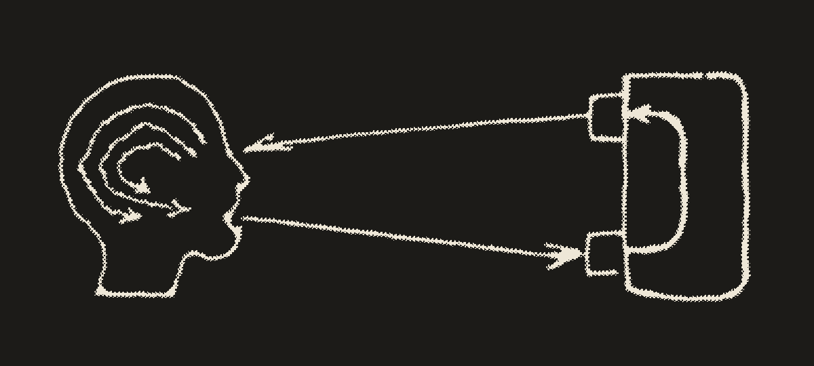</a></div>
<div class="band">
<p class="kicker">Part 1</p>

## What is agentic?
</div>

---

<p class="kicker">What is agentic · 1</p>

## Step 1: a pure LLM

- input: text
- output: the most likely next token, again and again
- it can *say* "run the tests"
- it cannot *run* anything

---

<p class="kicker">What is agentic · 2</p>

## Step 2: tool calling

The model emits a structured request instead of prose:

```json
{
  "tool": "bash",
  "arguments": { "cmd": "pytest -q" }
}
```

Something **outside** the model executes it and returns the result as text.

---

<p class="kicker">What is agentic · 3</p>

## Step 3: the loop

```text
model → tool call → result → model → tool call → result → … → answer
```

<div class="halftone fig">

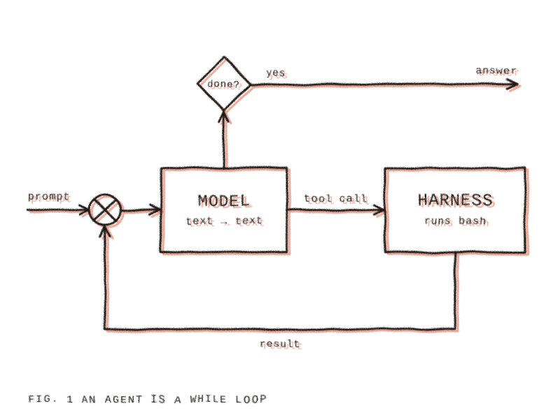

</div>

The model decides when it's done.

---

<!-- .slide: class="dense" -->

<p class="kicker">What is agentic · 4</p>

## An agent is a while loop

```python [1-13|15-22|23-27]
import json, subprocess
from openai import OpenAI

client = OpenAI(base_url="http://localhost:8000/v1", api_key="-")
tools = [{"type": "function", "function": {
    "name": "bash",
    "description": "Run a shell command",
    "parameters": {"type": "object",
        "properties": {"cmd": {"type": "string"}},
        "required": ["cmd"]}}}]

messages = [{"role": "system", "content": "You are a coding agent."},
            {"role": "user", "content": input("> ")}]

while True:
    msg = client.chat.completions.create(
        model="local-model", messages=messages, tools=tools
    ).choices[0].message
    messages.append(msg)
    if not msg.tool_calls:
        print(msg.content)
        break
    for call in msg.tool_calls:
        cmd = json.loads(call.function.arguments)["cmd"]
        out = subprocess.run(cmd, shell=True, capture_output=True, text=True)
        messages.append({"role": "tool", "tool_call_id": call.id,
                         "content": out.stdout + out.stderr})
```

<p class="caption">The same loop in pi: <a href="https://github.com/earendil-works/pi/blob/6a1f799b675c8cb98320b71ff7ee44f160fe8d66/packages/agent/src/agent-loop.ts#L163-L321">runLoop() in packages/agent/src/agent-loop.ts</a></p>

---

<p class="kicker">What is agentic · 5</p>

## Agenticness is a spectrum

<div class="cols wide-left middle">
<div>

1. **Autocomplete**: suggests the next line
2. **Chat**: you copy-paste between model and editor
3. **Agent with approvals**: acts, but asks before each step
4. **Delegated tasks**: agent acts until done, you review the result
5. **Autonomous agent**: runs for days in the background ([those things broke into Hugging Face](https://huggingface.co/blog/agent-intrusion-technical-timeline))

</div>
<div class="halftone">

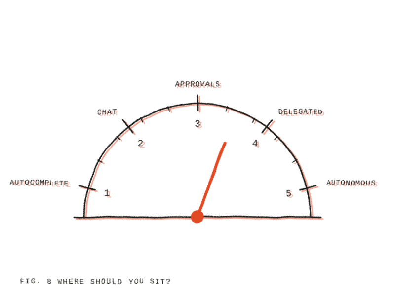

</div>
</div>

---

<!-- .slide: class="divider" -->

<div class="figure"></div>
<div class="band">
<p class="kicker">Part 2</p>

## Harnesses
</div>

---

<p class="kicker">Harnesses · 1</p>

## Agent = Model + Harness

<div class="cols wide-left middle">
<div>

The harness is everything around the model:

- system prompt
- tool definitions
- the loop
- context management
- permissions & UI

</div>
<div class="halftone">

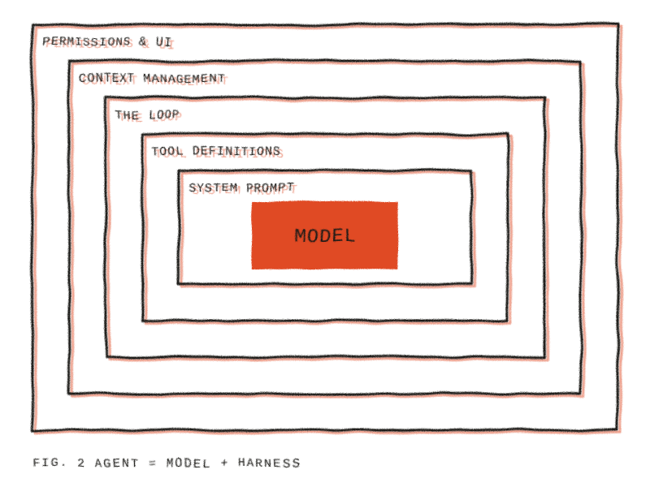

</div>
</div>

Different combinations of harnesses and models can lead to very different results.

---

<p class="kicker">Harnesses · 2</p>

## Some vocab

| Term | What it is |
|---|---|
| `AGENTS.md` | a file in your repo, loaded into every session |
| skill | instructions loaded only when relevant |
| prompt template | a saved prompt you call by name, e.g. `/review` |
| hook / extension | code the harness runs on events, e.g. after every edit |
| MCP | a standard plug for external tools |
| sub-agent | a second agent with its own context |

Commands are generally started with a `/`, eg. `/model`

---

<p class="kicker">Harnesses · 3</p>

## pi

A minimal, open-source coding agent harness: [pi.dev](https://pi.dev)

- by Mario Zechner, now maintained by Earendil
- MIT licensed
- philosophy: **primitives, not features**

---

<p class="kicker">Harnesses · 4</p>

## Just four tools

| Tool | Does |
|---|---|
| `read` | read a file |
| `write` | create / overwrite a file |
| `edit` | replace text in a file |
| `bash` | run anything else |

System prompt: under 1,000 tokens.

---

<p class="kicker">Harnesses · 5</p>

## Architecture

- `pi-ai`: unified access to model providers
- `pi-agent-core`: the agent loop
- `pi-tui`: terminal UI
- `pi-coding-agent`: the CLI you use

---

<p class="kicker">Harnesses · 6</p>

## What pi leaves out, on purpose

- no MCP by default
- no sub-agents
- no plan mode
- no permission prompts

→ **extensions** (TypeScript), **skills**, **prompt templates**, **packages**

---

<p class="kicker">Harnesses · 7</p>

## The system prompt

*(show it)*

---

<!-- .slide: class="divider" -->

<div class="figure"></div>
<div class="band">
<p class="kicker">Part 3</p>

## Context engineering
</div>

---

<p class="kicker">Context · 1</p>

## Context is the scarce resource

The context window is the model's entire working memory.

Everything it should know about your task must be in there.

It fills up, and models output quality decreases with size.

---

<p class="kicker">Context · 2</p>

## What fills the context

<div class="cols wide-right middle">
<div>

- system prompt
- AGENTS.md
- skill descriptions
- your messages
- every file it reads
- every tool output (test logs!)

</div>
<div class="halftone">

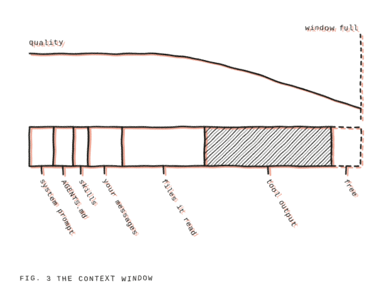

</div>
</div>

---

<p class="kicker">Context · 3</p>

## What protects the context

- **compaction**: summarize old history
- **skills**: load instructions only when relevant
- **sub-agents**: do work in a separate context, return a summary
- **fresh sessions**: start over with a good AGENTS.md

---

<!-- .slide: class="divider" -->

<div class="figure"><a class="pic-link" href="https://en.wikipedia.org/wiki/Brain_stimulation_reward" target="_blank"></a></div>
<div class="band">
<p class="kicker">Part 4</p>

## Only as good as its signals
</div>

---

<p class="kicker">Signals · 1</p>

## Agents optimize what is checked

<div class="cols wide-left middle">
<div>

- trained with rewards for passing checks
- when check and intent diverge, the check wins
- this is called **reward hacking**

</div>
<div class="halftone">

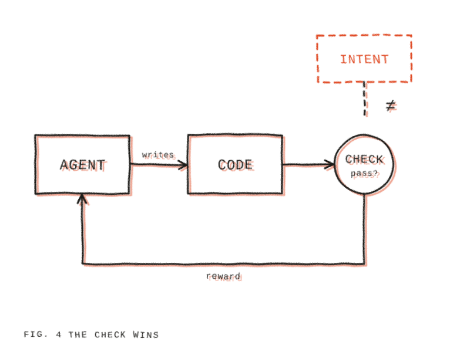

</div>
</div>

---

<p class="kicker">Signals · 2</p>

## What it looks like

- tests get weakened or deleted
- special cases for test inputs
- `try/except: pass`
- "done!" when it isn't

---

<p class="kicker">Signals · 3</p>

## Back to our tokenizer

---

<p class="kicker">Signals · 4</p>

## But what if agents misbehave?

```python
def encode(text): return list(text.encode("utf-8"))
def decode(ids): return bytes(ids).decode("utf-8")
```

This would pass the roundtrip test.

It never merges anything.

<p class="fragment"><strong>We</strong> never defined what correct means.</p>

---

<p class="kicker">Signals · 5</p>

## It gets worse with scale

[SpecBench (2026)](https://arxiv.org/abs/2605.21384):

- agents saturate visible tests
- held-out tests reveal the gap
- the gap grows with code size

---

<!-- .slide: class="statement" -->

<div>
<div class="num">88%</div>

# fewer exploits

Simply hardening the environment cut exploits without hurting task success. → Fix the signals, not the model.

[Reward Hacking Benchmark, ICML 2026](https://openreview.net/pdf?id=YMA0ByEdVj)
</div>

---

<!-- .slide: class="divider" -->

<div class="figure"><a class="pic-link" href="https://en.wikipedia.org/wiki/Sketchpad" target="_blank"></a></div>
<div class="band">
<p class="kicker">Part 5</p>

## Showcase and Tutorial
</div>

---

<p class="kicker">Showcase · 1</p>

## How to get started

<div class="cols wide-left middle">
<div>

Logging in:

- with Copilot Student
  - `pi install git:github.com/lorenzprattes/pi-copilot-student@v0.1.1`
- with Opencode Go
  - disable global region in the settings
  - generate API key
- ... log in!

Step by step: [getting started with coding agents](https://github.com/ruggsea/fundamentals-of-llms-course/blob/main/agentic-coding/getting-started.md)

</div>
<div class="halftone">

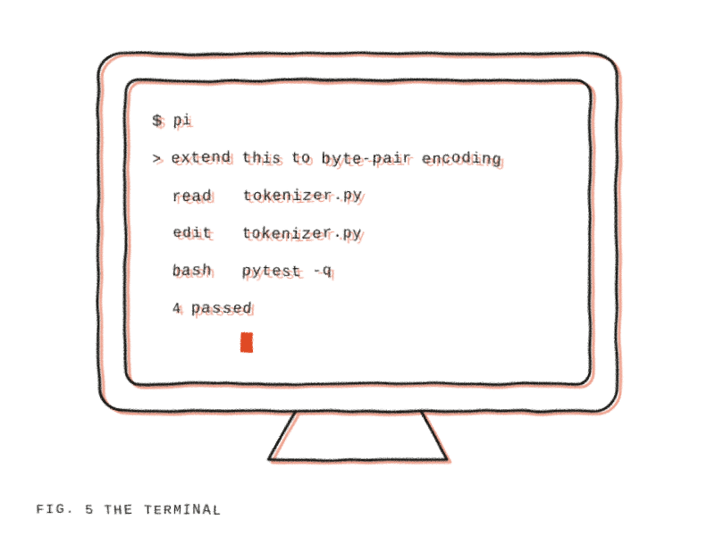

</div>
</div>

---

<!-- .slide: class="divider" -->

<div class="figure">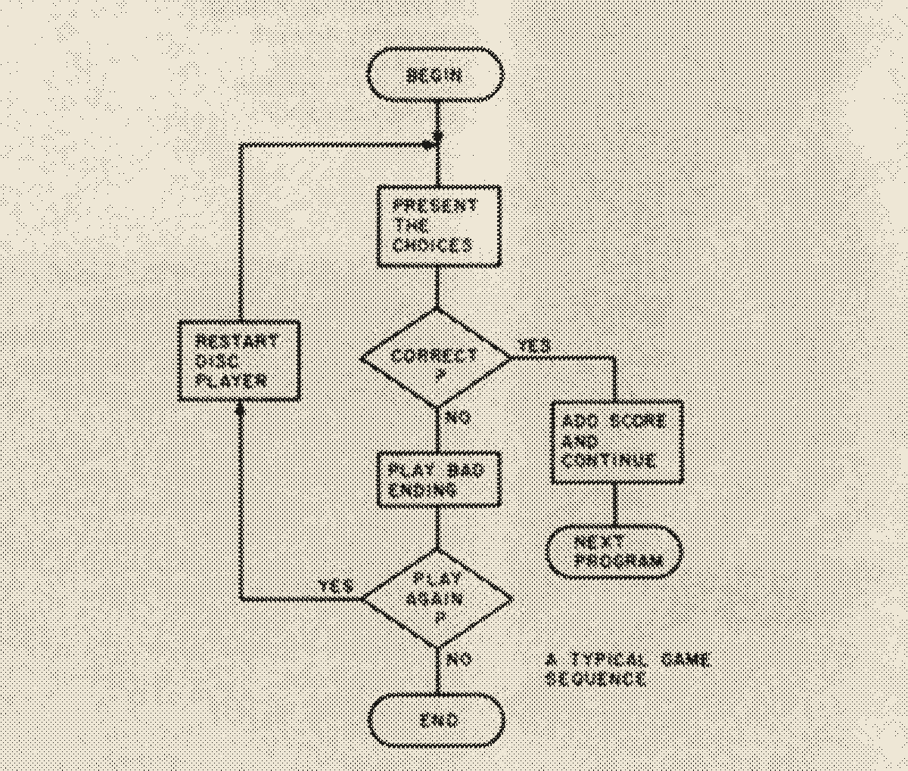</div>
<div class="band">
<p class="kicker">Part 6</p>

## Upgrading it
</div>

---

<!-- .slide: class="statement" -->

<div>

# The human's job moves

from writing code to **defining "done"** and **building the checks**

> "Look a bit closer though and you’ll note that defining goals, providing unambiguous instructions, and figuring out the right tools... is kind of what software engineering is."
> <cite>Simon Willison, <a href="https://simonwillison.net/2026/Sep/27/2026-in-llms-so-far/">2026 in LLMs (so far)</a></cite>
</div>

---

<p class="kicker">Upgrade · 1</p>

## 1. A spec

```markdown
# SPEC: byte-level BPE tokenizer

- `BPE.train(text, vocab_size)` learns merges
- `BPE.from_ranks(ranks, pattern)` loads existing merges
- `encode(text) -> list[int]`, `decode(ids) -> str`
- merges are applied in order of rank, not frequency
- pre-split text with the GPT-2 regex (use the `regex` package)
- must handle any unicode input

Non-goals: special tokens, speed
```

---

<!-- .slide: class="dense" -->

<p class="kicker">Upgrade · 2</p>

## 2. Tests you write with the agent, but read yourself

```python [1-6|8-10|12-14|16-18]
import tiktoken
from hypothesis import given, strategies as st
from tokenizer import BPE

gpt2 = tiktoken.get_encoding("gpt2")
ours = BPE.from_ranks(gpt2._mergeable_ranks, pattern=gpt2._pat_str)

def test_toy_merge():
    bpe = BPE.train("aaabdaaabac", vocab_size=257)
    assert bpe.merges == {(97, 97): 256}

@given(st.text())
def test_roundtrip(s):
    assert ours.decode(ours.encode(s)) == s

@given(st.text())
def test_matches_gpt2(s):
    assert ours.encode(s) == gpt2.encode(s, disallowed_special=())
```

---

<p class="kicker">Upgrade · 3</p>

## Test oracle & property-based tests

- **oracle**: a trusted reference that knows the right answer
- **property-based test**: state a rule, let a library generate the inputs

---

<p class="kicker">Upgrade · 4</p>

## 3. Checks that run automatically

- tests run after every edit
- the agent sees failures without you
- in pi: a small extension hooking tool events

---

<p class="kicker">Upgrade · 5</p>

## 4. A reviewer with fresh eyes

> "Review this diff against SPEC.md. Were any tests weakened? Is anything special-cased?"

- separate context
- ideally a different model

---

<p class="kicker">Upgrade · 6</p>

## 5. Turn every mistake into a rule

<div class="cols wide-right middle">
<div>

Every time the agent fails → one more line in AGENTS.md or one more check.

</div>
<div class="halftone">

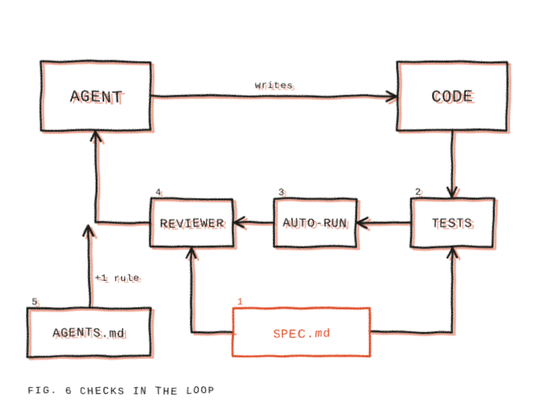

</div>
</div>

---

<!-- .slide: class="divider" -->

<div class="figure"><a class="pic-link" href="https://commons.wikimedia.org/wiki/File:The_Trojans_pulling_the_wooden_horse_into_the_city_MET_DP370729.jpg" target="_blank">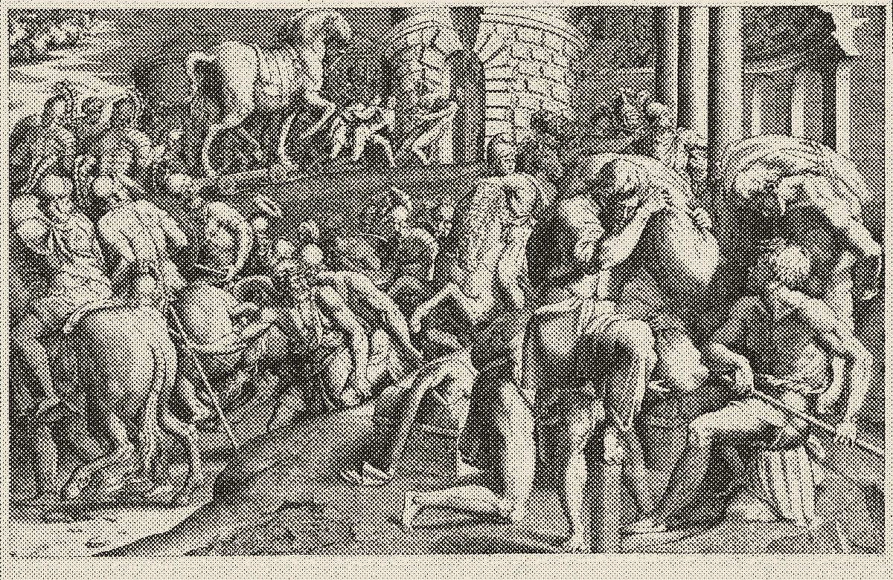</a></div>
<div class="band">
<p class="kicker">Part 7</p>

## Safety
</div>

---

<p class="kicker">Safety · 1</p>

## Bash access means everything

The agent can do anything **you** can do:

- read your SSH keys
- read API keys in env variables
- `rm -rf`
- send data anywhere

pi asks no permission by default.

---

<p class="kicker">Safety · 2</p>

## Sandboxes

- **container**: isolated filesystem, shared kernel
- **VM**: full isolation, throwaway machine
- limit network access
- keep secrets outside the sandbox

---

<p class="kicker">Safety · 3</p>

## Prompt injection

Instructions hidden in content the agent reads:

- a README
- a web page
- an issue comment
- a dependency

The model can't reliably tell your instructions from someone else's.

---

<p class="kicker">Safety · 4</p>

## The lethal trifecta

<div class="cols middle">
<div>

1. access to **private data**
2. exposure to **untrusted content**
3. ability to **communicate externally**

All three together → potentially very bad

</div>
<div class="halftone">

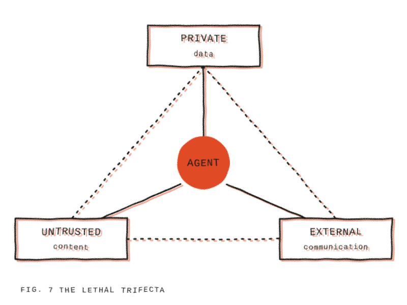

</div>
</div>

<p class="caption">Simon Willison, <a href="https://simonwillison.net/2025/Jun/16/the-lethal-trifecta/" target="_blank">The lethal trifecta for AI agents</a>, June 2025</p>

---

<!-- .slide: class="divider" -->

<div class="figure"><a class="pic-link" href="https://en.wikipedia.org/wiki/The_Human_Use_of_Human_Beings" target="_blank"></a></div>
<div class="band">
<p class="kicker">Part 8</p>

## When to limit
</div>

---

<p class="kicker">Limits · 1</p>

## Where agents shine

- well-specified tasks
- verifiable results
- boilerplate, refactoring, migrations
- prototypes you'll throw away

Our tokenizer: a spec plus an oracle → ideal.

---

<p class="kicker">Limits · 2</p>

## Cognitive debt

<div class="cols wide-left middle">
<div>

You will not understand everything that your agents are doing anymore.

Therefore you will have to carefully decide where you invest your attention.

We have to optimize for two things: 
- Creating working software
- Personal Learning 

</div>
<div>

<a class="pic-link" href="https://en.wikipedia.org/wiki/The_Captive_Mind" target="_blank">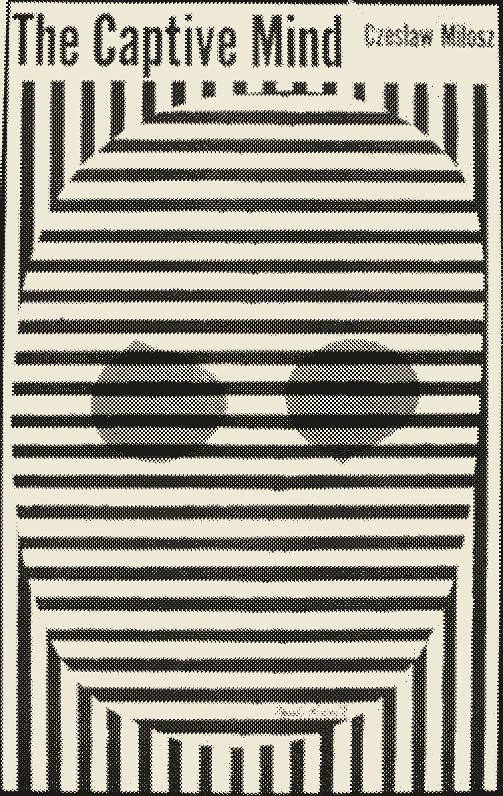</a>

</div>
</div>

---

<p class="kicker">Limits · 3</p>

## How to handle cognitive debt and AI mania

- Practice thinking outside of chats
- Increment small
- Explain the code, with closed chat
- Vary your attention according to what you want to learn

---

<p class="kicker">Limits · 4</p>

## Learning

[Anthropic study, 2026](https://www.anthropic.com/research/AI-assistance-coding-skills), 52 developers learning a new library:

- with AI: ~50% on the quiz
- by hand: ~67%
- biggest gap: **debugging**

But: those who used AI to *understand* kept their skills.

---

<p class="kicker">Limits · 5</p>

## Cost

- every loop iteration is tokens
- long sessions, many agents → real money
- productivity gains are hard to measure

---

<p class="kicker">Takeaways</p>

## Takeaways

1. An agent is a while loop with tools.
2. The harness matters as much as the model.
3. Context is scarce, protect it.
4. Agents optimize your checks, so make the checks right.
5. Sandbox anything with bash.
6. Use it to understand, not only to produce.

---

<!-- .slide: class="dense" -->

<p class="kicker">Reading</p>

## Literature

<div class="cols reading">
<div>

**Guides and essays**

- Simon Willison: [2026 in LLMs (so far)](https://simonwillison.net/2026/Sep/27/2026-in-llms-so-far/) *(highly recommended)*
- Simon Willison: [Agentic Engineering Patterns](https://simonwillison.net/guides/agentic-engineering-patterns/)
- Simon Willison: [The lethal trifecta for AI agents](https://simonwillison.net/2025/Jun/16/the-lethal-trifecta/)
- Anthropic: [Building effective agents](https://www.anthropic.com/engineering/building-effective-agents)
- Anthropic: [Effective context engineering for AI agents](https://www.anthropic.com/engineering/effective-context-engineering-for-ai-agents)
- Anthropic: [Effective harnesses for long-running agents](https://www.anthropic.com/engineering/effective-harnesses-for-long-running-agents)
- Addy Osmani: [Agent Harness Engineering](https://addyosmani.com/blog/agent-harness-engineering/)

</div>
<div>

**Research**

- Anthropic: [How AI assistance impacts the formation of coding skills](https://www.anthropic.com/research/AI-assistance-coding-skills)
- [Reward Hacking Benchmark](https://openreview.net/pdf?id=YMA0ByEdVj) (ICML 2026)
- Gabor et al.: [EvilGenie: A Reward Hacking Benchmark](https://arxiv.org/abs/2511.21654)
- Zhao et al.: [SpecBench: Measuring Reward Hacking in Long-Horizon Coding Agents](https://arxiv.org/abs/2605.21384) (2026)
- Hugging Face: [Agent intrusion, technical timeline](https://huggingface.co/blog/agent-intrusion-technical-timeline) (2026)

**Tools**

- [pi.dev](https://pi.dev)
- [Getting started with coding agents](https://github.com/ruggsea/fundamentals-of-llms-course/blob/main/agentic-coding/getting-started.md): setup for the workshop

</div>
</div>

---

<!-- .slide: class="title" -->

<div class="text">

# Questions?

<p class="kicker">Lorenz Prattes</p>
</div>
